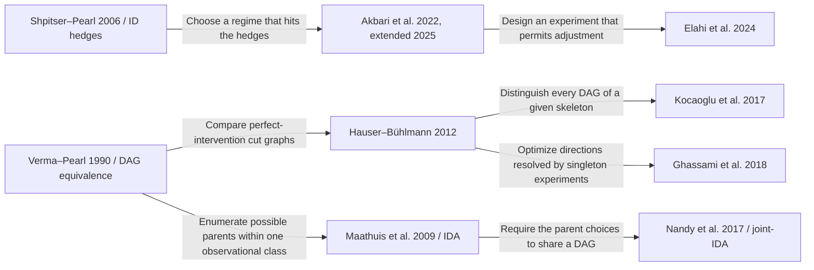

# Causal graph foundations

The [Lean cases](../OpenCausalScience/Examples/DSeparation.lean) check d-separation on four-vertex collider, chain, and fork graphs using the project's finite DAG library. The topics below follow their mathematical dependencies.

## Statistical graphical models

- **Conditional independence and support.** [Dawid](papers/dawid-1979-conditional-independence.md) supplies the finite event-cell laws used in the probability companions. The support condition for intersection and the limits of composition have separate exact witnesses.
- **Undirected models.** [Besag](papers/besag-1974-spatial-interaction.md), [Grimmett](papers/grimmett-1973-random-fields.md), and [Darroch, Lauritzen and Speed](papers/darroch-lauritzen-speed-1980-log-linear-markov-fields.md) connect the pairwise Markov property and clique factorization. [Moussouris](papers/moussouris-1974-gibbs-markov-constraints.md) gives the four-cycle support obstruction.
- **Directed models.** [Kiiveri, Speed and Carlin](papers/kiiveri-speed-carlin-1984-recursive-causal-models.md) contrast conditioning on a collider with the independence read from the undirected skeleton. [Lauritzen, Dawid, Larsen and Leimer](papers/lauritzen-et-al-1990-directed-markov-fields.md) connect local CI, a recursive mass product, and ancestral moral separation.
- **Clique computations.** [Lauritzen, Speed and Vijayan](papers/lauritzen-speed-vijayan-1984-decomposable-graphs.md) connect clique decomposition with triangulation. Given a perfect elimination order, Lean constructs bags with running intersection. [Lauritzen and Spiegelhalter](papers/lauritzen-spiegelhalter-1988-local-computations.md) supply the probability computation scope, with verified upward messages and compatible finite clique marginals.
- **Directed and undirected chain graphs.** [Lauritzen and Wermuth](papers/lauritzen-wermuth-1989-graphical-models.md) and [Frydenberg](papers/frydenberg-1990-chain-graph-markov.md) develop the LWF reading. [Andersson, Madigan and Perlman](papers/andersson-et-al-2001-amp-chain-graphs.md) give the AMP alternative. The three-vertex flag and [Drton's four-vertex example](papers/drton-2009-discrete-chain-graph-models.md) check how the readings differ. The [AMP separation companion](papers/levitz-et-al-2001-amp-p-separation.md) tracks the published table correction. [Lauritzen and Richardson](papers/lauritzen-richardson-2002-causal-chain-graphs.md) give the feedback interpretation and intervention questions.
- **ADMGs and marked mixed graphs.** [Richardson's ordered-local property](papers/richardson-2003-ordered-local-markov.md) and [head–tail partitions](papers/richardson-2009-admg-factorization.md) connect ADMG separation and finite probability calculations. The [mixed-graph Markov companion](papers/sadeghi-lauritzen-2014-mixed-graph-markov.md) proves the compositional graphoid rules on OCS's marked graph type. The [connecting-walk companion](papers/lauritzen-sadeghi-2018-unifying-markov.md) compares two separation definitions on the same graph domain.

## DAG separation and causal identification

1. **d-Separation.** Start with the executable active-path criterion for finite DAGs. Connect it to the lecture's direction-sensitive search by proving the correspondence. A subsequent theorem relates graph separation to conditional independence under the global Markov property. [Geiger, Verma, and Pearl, Networks, 1990](https://doi.org/10.1002/net.3230200504) · [Shachter, UAI, 1998](https://web.stanford.edu/~shachter/pubs/bayesbl.pdf)
2. **Do-calculus.** Define intervention graph operations, then check the graphical premises of a rule on a worked example. The finite probability identity for supported action–observation exchange is in the [Rule 2 companion](papers/pearl-1995-do-calculus.md). [Pearl, Biometrika, 1995](https://doi.org/10.1093/biomet/82.4.669)
3. **Tian's Identify procedure.** Ancestral marginalization and c-component extraction compute one causal factor from another. The [Q-decomposition companion](papers/tian-pearl-2003-q-decomposition.md) proves these steps for finite independent-root SCMs and uses them to justify successful execution of the graph plan under observational positivity. The 2003 report leaves identifiability unresolved when the ancestral reduction stalls. [Tian, 2002 dissertation](https://ftp.cs.ucla.edu/pub/stat_ser/r309.pdf) · [Tian and Pearl, 2003, Figure 7 and following discussion](https://ftp.cs.ucla.edu/pub/stat_ser/R290-L.pdf#page=26)
4. **Observational ID.** The [joint ID companion](papers/shpitser-pearl-2006-joint-id.md) proves that intervening on additional nonancestors leaves the query unchanged. The [graphical fixing companion](papers/richardson-et-al-2023-nested-markov.md) proves the persistence of fixable choices. A [later note by Shpitser](papers/shpitser-2023-id-failure.md) characterizes failure using the exact input query. [Huang and Valtorta, AAAI, 2006](https://cdn.aaai.org/AAAI/2006/AAAI06-180.pdf) · [Huang and Valtorta, UAI, 2006](https://www.cse.sc.edu/~mgv/papers/HuangValtortaUAI06.pdf)
5. **Conditional and partial-graph identification.** The [Tian companion](papers/tian-2004-conditional-effects.md) proves that Tian's failure test agrees with joint ID after IDC's Rule 2 exchanges on finite ADMGs. The [IDC companion](papers/shpitser-pearl-2006-conditional-idc.md) checks an exchange and normalization step and replays the example discussed in the author's 2007 Appendum. The [MPDAG companion](papers/perkovic-2020-partial-causal-order.md) verifies the partial causal order of the buckets, and the [original PAG IDP companion](papers/jaber-zhang-bareinboim-2019-idp.md) checks the worked recursive decomposition.

## Selection recovery

1. **Population probabilities.** The [2014 companion](papers/bareinboim-tian-pearl-2014-selection-recovery.md) checks recovery of conditional cells and the search for a separating subset of available population covariates.
2. **Causal effects from selected data.** The [RC companion](papers/bareinboim-tian-2015-selection-recovery.md) checks recursive kernel extraction and division, with both recovery and failure cases. The [2019 companion](papers/correa-tian-bareinboim-2019-selection-identification.md#where-the-selected-only-rc-procedure-stops) checks the public six-vertex example in which RC stops and selected-only adjustment recovers the target.
3. **Causal effects with external data.** The [generalized adjustment companion](papers/correa-tian-bareinboim-2018-selection-adjustment.md) verifies the criterion for a pair of adjustment sets and its two-source formula. The [IDSB companion](papers/correa-tian-bareinboim-2019-selection-identification.md) checks population extension, mixed-source district factors, and the ratio in Figure 2(b).

## Counterfactual identification and path-specific effects

1. **Parallel worlds.** The [ID* and IDC* companion](papers/shpitser-pearl-2008-counterfactual-id.md) proves that merging equivalent world copies preserves event mass and checks the published exchange, district, and normalization trace.
2. **Nested queries and available sources.** The [CTFID companion](papers/correa-lee-bareinboim-2021-counterfactual-identification.md) proves the finite unnesting identity, checks which experiments supply a district kernel, and proves a conditional cancellation on Figure 6(a).
3. **Selected paths.** The [recanting witness companion](papers/avin-shpitser-pearl-2005-path-specific-effects.md) gives an exact two-model witness. The [recanting district companion](papers/shpitser-2013-longitudinal-mediation.md) verifies the finite ADMG criterion. The [edge g-formula](papers/shpitser-tchetgen-tchetgen-2016-intervention-hierarchy.md) and the [PS-IDC companion](papers/malinsky-shpitser-richardson-2019-conditional-path-effects.md) check edge interventions and the examples that distinguish marginal from conditional path-specific identification.

## DAG equivalence and discovery

1. **Markov equivalence and essential graphs.** The [Verma–Pearl companion](papers/verma-pearl-1990-dag-equivalence.md) characterizes equivalence by skeletons and unshielded colliders. The [covered reversal companion](papers/chickering-1995-covered-reversals.md) proves d-separation preservation and constructs a sequence of reversals toward an equivalent DAG. The [essential-graph companion](papers/andersson-madigan-perlman-1997-essential-graphs.md) proves that the compelled arrows order chordal components. The [PDAG extension companion](papers/wienobst-bannach-liskiewicz-2021-pdag-extension.md) characterizes consistent extensions by potential-sink elimination.
2. **PC.** The [oracle PC companion](papers/spirtes-glymour-1991-pc.md) proves exact skeleton recovery and unshielded-collider detection under agreement between the oracle and d-separation. The [orientation companion](papers/meek-1995-orientation.md) proves R1–R4 soundness, preservation of consistent extensions, and maximal orientation on complete skeletons. Meek's Theorem 3 gives maximal orientation for DAG patterns under R1–R3. Theorem 4 adds R4 and consistent background knowledge. [Meek, UAI, 1995](https://arxiv.org/abs/1302.4972)
3. **Greedy equivalence search (GES).** The [Insert and Delete companion](papers/chickering-2002-greedy-equivalence-search.md) proves the validity tests in both directions on the essential graph of any finite DAG. The two-phase large-sample result additionally needs the score and distribution assumptions that make the search consistent. [Chickering, JMLR, 2002](https://jmlr.org/papers/v3/chickering02b.html)

4. **Permutation-based discovery.** A shared [ordered Markov result](../OpenCausalScience/Discovery/OrderedMarkov.lean) derives the global Markov property of the order DAG from a graphoid and the singleton CI oracle. The [sparsest permutation companion](papers/raskutti-uhler-2018-sparsest-permutations.md) proves exhaustive oracle recovery under the sparsest Markov representation condition. The [GRaSP companion](papers/lam-et-al-2022-grasp.md) connects the inclusion transformation to covered tuck paths and MEC recovery. The [BOSS companion](papers/andrews-et-al-2023-boss.md) proves the population projection guarantee and connects it to backward equivalence search. Both greedy recovery proofs use the checked [Chickering transformation](papers/chickering-2002-greedy-equivalence-search.md#the-inclusion-transformation).

## Latent variables, selection, and FCI

1. **Ancestral graphs and MAG equivalence.** Extend path separation to m-separation. Start by checking one inducing-path or marginalization example, then introduce maximal ancestral graphs (MAGs) and the characterization by adjacencies and colliders with order. Ancestral graphs representing selection can include undirected edges. State the allowed edge types for each example. [Richardson and Spirtes, 2002](https://www.cmu.edu/dietrich/philosophy/docs/spirtes/annals2002.pdf) · [Ali, Richardson, and Spirtes, 2009, Theorem 3.7](https://www.cmu.edu/dietrich/philosophy/docs/spirtes/AOS626.pdf)
2. **PAGs and Fast Causal Inference (FCI).** Define a partial ancestral graph by the invariant endpoint marks of a MAG equivalence class. Start with orienting an unshielded collider from an oracle separating set, then study a discriminating-path example. Zhang's completeness result concerns invariant marks under the stated causal assumptions, allowing latent confounding and selection bias. Ancestral-graph do-calculus is a later identification topic. [Spirtes, Meek, and Richardson, UAI, 1995](https://www.microsoft.com/en-us/research/publication/causal-inference-in-the-presence-of-latent-variables-and-selection-bias/) · [Jiji Zhang, Artificial Intelligence, 2008](https://doi.org/10.1016/j.artint.2008.08.001) · [Jiji Zhang, JMLR, 2008](https://www.jmlr.org/papers/v9/zhang08a.html)

## Experiment design and interventional equivalence

The arrows show how the research question changes or which graph result the
next formalization reuses.

The effect-specific line starts with a known graph and a target query.
The [minimum-cost district companion](papers/akbari-et-al-2025-optimal-experiment-design.md)
checks how a single experiment resolves the hedges and which targets are
optimal in the worked example. The [proxy experiment companion](papers/elahi-et-al-2024-fast-proxy-experiment-design.md)
checks the graph cut for adjustment and verifies the outcome-intervention
counterexample. The protected cut keeps the target mechanisms available.
The companion also proves the external-intervention identity for ranked
binary SCMs.

The structure-learning line starts with candidates for the unknown graph.
The [cut-graph companion](papers/hauser-buhlmann-2012-interventional-equivalence.md)
gives the graph-level equivalence criterion. The
[minimum-cost skeleton companion](papers/kocaoglu-et-al-2017-cost-optimal-graph-learning.md)
checks when a design distinguishes every orientation and derives its cost
from vertex covers. The [budgeted orientation companion](papers/ghassami-et-al-2018-budgeted-experiment-design.md)
proves that the number of resolved directions increases when more singleton
experiments become available. Interventional essential-graph characterization
and budgeted submodularity remain proof targets.

The [IDA](papers/maathuis-kalisch-buhlmann-2009-ida.md) and
[joint-IDA](papers/nandy-maathuis-richardson-2017-joint-ida.md) companions
use one observational CPDAG. They show how compatible parent sets describe
the available effect calculations as the representative DAG varies.

### Interventions with latent variables

The [latent experimental-design companion](papers/kocaoglu-et-al-2017-latent-experimental-design.md)
checks how a separating set of randomized experiments recovers ancestry
among observed vertices. The [controlled soft-intervention companion](papers/kocaoglu-et-al-2019-controlled-soft-interventions.md)
uses comparison roots constructed from known target differences. The
[unknown-target companion](papers/jaber-et-al-2020-unknown-soft-targets.md)
records differences between mechanisms for each pair of regimes. Both
use ancestral marginalization to obtain augmented MAGs. Lean checks the
root construction and the published separation examples. CGA compares
the augmented MAGs, including examples with different proposed targets.

## Missing data and selection recovery

The [Mohan–Pearl–Tian companion](papers/mohan-et-al-2013-missing-data.md)
uses observed response rates to recover the target joint, including in
the cross-censoring example. The [2014 testability companion](papers/mohan-pearl-2014-missing-data-testability.md)
checks observable restrictions of the model. The
[2018 example](papers/mohan-pearl-2018-consistent-estimation-missing-data.md)
and [2021 survey companion](papers/mohan-pearl-2021-missing-data-factorization.md)
recover supported conditional and joint cells from observed proxies.

[Complete-case selection](papers/mohan-pearl-2018-consistent-estimation-missing-data.md#what-complete-case-selection-retains)
connects these results to [selection recovery](#selection-recovery).
The complete-case conditional and the population stratum margin together
give the population joint. A missing-data record can retain the stratum
in an incomplete row. With selected-only data the population margin must
come from other information. Two positive binary models illustrate this
difference: their complete cases agree and their population joints differ.

The [Nabi–Bhattacharya–Shpitser companion](papers/nabi-et-al-2020-missing-data-full-law.md)
checks self-censoring in a binary model and characterizes the graph structure
of colluding paths. Its full-law query includes the response mechanism.
The general probability-level odds-ratio recovery remains a proof target.

## Single-world graphs

The [single-world intervention graph companion](papers/richardson-robins-2013-swig.md)
checks node splitting, path maps and fixed-label rules. The probability
factorization remains a proof target.

## Linear graphical models

The [trek separation companion](papers/sullivant-et-al-2010-trek-separation.md)
proves the graph reduction to two-copy reachability. The
[one-factor tetrad companion](papers/silva-et-al-2006-linear-latent-structure.md)
derives the covariance equality for four distinct indicators with
uncorrelated measurement errors. The
[half-trek paper companion](papers/foygel-et-al-2012-half-trek-criterion.md)
checks two instrumental-variable coefficient ratios. The general
covariance rank theorem, half-trek witnesses and clustering guarantee
remain proof targets.
