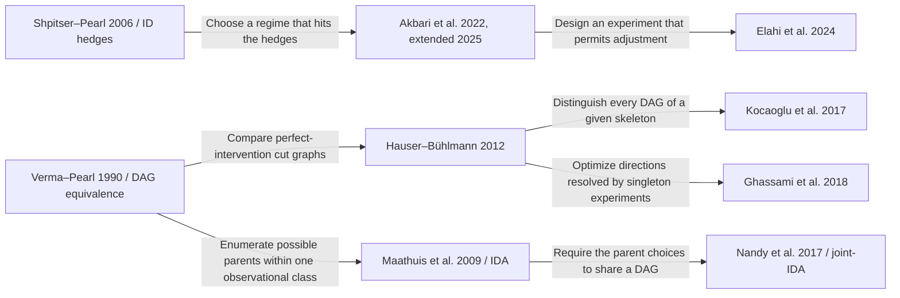

# Causal graph foundations

The [Lean cases](../OpenCausalScience/Examples/DSeparation.lean) check d-separation on four-vertex collider, chain, and fork graphs using the project's finite DAG library. The topics below follow their mathematical dependencies.

## DAG separation and causal identification

1. **d-Separation.** Start with the executable active-path criterion for finite DAGs. Connect it to the lecture's direction-sensitive search by proving the correspondence. A subsequent theorem relates graph separation to conditional independence under the global Markov property. [Geiger, Verma, and Pearl, Networks, 1990](https://doi.org/10.1002/net.3230200504) · [Shachter, UAI, 1998](https://web.stanford.edu/~shachter/pubs/bayesbl.pdf)
2. **Do-calculus.** Define intervention graph operations, then check the graphical premises of a rule on a worked example. The finite probability identity for supported action–observation exchange is in the [Rule 2 companion](papers/pearl-1995-do-calculus.md). [Pearl, Biometrika, 1995](https://doi.org/10.1093/biomet/82.4.669)
3. **Tian's Identify procedure.** Introduce causal diagrams with directed and bidirected edges for latent confounding. Start with ancestral marginalization and c-component factorization. The recursion uses these steps to compute one interventional kernel from another. The [Q-decomposition companion](papers/tian-pearl-2003-q-decomposition.md) proves the prefix-ratio telescoping step. The 2003 report leaves identifiability unresolved when the ancestral reduction stalls. [Tian, 2002 dissertation](https://ftp.cs.ucla.edu/pub/stat_ser/r309.pdf) · [Tian and Pearl, 2003, Figure 7 and following discussion](https://ftp.cs.ucla.edu/pub/stat_ser/R290-L.pdf#page=26)
4. **Observational ID.** The [joint ID companion](papers/shpitser-pearl-2006-joint-id.md) proves that intervening on additional nonancestors leaves the query unchanged. The [graphical fixing companion](papers/richardson-et-al-2023-nested-markov.md) proves the persistence of fixable choices. A [later note by Shpitser](papers/shpitser-2023-id-failure.md) characterizes failure using the exact input query. [Huang and Valtorta, AAAI, 2006](https://cdn.aaai.org/AAAI/2006/AAAI06-180.pdf) · [Huang and Valtorta, UAI, 2006](https://www.cse.sc.edu/~mgv/papers/HuangValtortaUAI06.pdf)
5. **Conditional and partial-graph identification.** The [Tian companion](papers/tian-2004-conditional-effects.md) proves that Tian's failure test agrees with joint ID after IDC's Rule 2 exchanges on finite ADMGs. The [IDC companion](papers/shpitser-pearl-2006-conditional-idc.md) checks an exchange and normalization step and replays the example discussed in the author's 2007 Appendum. The [MPDAG companion](papers/perkovic-2020-partial-causal-order.md) verifies the partial causal order of the buckets, and the [original PAG IDP companion](papers/jaber-zhang-bareinboim-2019-idp.md) checks the worked recursive decomposition.

## Selection recovery

1. **Population probabilities.** The [2014 companion](papers/bareinboim-tian-pearl-2014-selection-recovery.md) checks recovery of conditional cells and the search for a separating subset of available population covariates.
2. **Causal effects from selected data.** The [RC companion](papers/bareinboim-tian-2015-selection-recovery.md) checks recursive kernel extraction and division, with both recovery and failure cases. The [2019 companion](papers/correa-tian-bareinboim-2019-selection-identification.md#where-the-selected-only-rc-procedure-stops) checks the public six-vertex example in which RC stops and selected-only adjustment recovers the target.
3. **Causal effects with external data.** The [generalized adjustment companion](papers/correa-tian-bareinboim-2018-selection-adjustment.md) verifies the criterion for a pair of adjustment sets and its two-source formula. The [IDSB companion](papers/correa-tian-bareinboim-2019-selection-identification.md) checks population extension, mixed-source district factors, and the ratio in Figure 2(b).

## Counterfactual identification and path-specific effects

1. **Parallel worlds.** The [ID* and IDC* companion](papers/shpitser-pearl-2008-counterfactual-id.md) proves that merging equivalent world copies preserves event mass and checks the published exchange, district, and normalization trace.
2. **Nested queries and available sources.** The [CTFID companion](papers/correa-lee-bareinboim-2021-counterfactual-identification.md) proves the finite unnesting identity, checks which experiments supply a district kernel, and proves a conditional cancellation on Figure 6(a).
3. **Selected paths.** The [recanting witness companion](papers/avin-shpitser-pearl-2005-path-specific-effects.md) gives an exact two-model witness. The [recanting district companion](papers/shpitser-2013-longitudinal-mediation.md) verifies the finite ADMG criterion. The [edge g-formula](papers/shpitser-tchetgen-tchetgen-2016-intervention-hierarchy.md) and the [PS-IDC companion](papers/malinsky-shpitser-richardson-2019-conditional-path-effects.md) check edge interventions and the examples that distinguish marginal from conditional path-specific identification.

## DAG equivalence and discovery

1. **Markov equivalence and essential graphs.** The [Verma–Pearl companion](papers/verma-pearl-1990-dag-equivalence.md) characterizes equivalence by skeletons and unshielded colliders. The [covered reversal companion](papers/chickering-1995-covered-reversals.md) proves d-separation preservation and constructs a sequence of reversals toward an equivalent DAG. The [essential-graph companion](papers/andersson-madigan-perlman-1997-essential-graphs.md) proves that the compelled arrows order chordal components. The [PDAG extension companion](papers/wienobst-bannach-liskiewicz-2021-pdag-extension.md) characterizes consistent extensions by potential-sink elimination.
2. **PC.** The [oracle PC companion](papers/spirtes-glymour-1991-pc.md) proves exact skeleton recovery and unshielded-collider detection under agreement between the oracle and d-separation. The [orientation companion](papers/meek-1995-orientation.md) proves R1–R4 soundness, preservation of consistent extensions, and maximal orientation on complete skeletons. Meek's Theorem 3 gives maximal orientation for DAG patterns under R1–R3. Theorem 4 adds R4 and consistent background knowledge. [Meek, UAI, 1995](https://arxiv.org/abs/1302.4972)
3. **Greedy equivalence search (GES).** The [Insert and Delete companion](papers/chickering-2002-greedy-equivalence-search.md) proves the validity tests in both directions on the essential graph of any finite DAG. The two-phase large-sample result additionally needs the score and distribution assumptions that make the search consistent. [Chickering, JMLR, 2002](https://jmlr.org/papers/v3/chickering02b.html)

## Latent variables, selection, and FCI

1. **Ancestral graphs and MAG equivalence.** Extend path separation to m-separation. Start by checking one inducing-path or marginalization example, then introduce maximal ancestral graphs (MAGs) and the characterization by adjacencies and colliders with order. Ancestral graphs representing selection can include undirected edges. State the allowed edge types for each example. [Richardson and Spirtes, 2002](https://www.cmu.edu/dietrich/philosophy/docs/spirtes/annals2002.pdf) · [Ali, Richardson, and Spirtes, 2009, Theorem 3.7](https://www.cmu.edu/dietrich/philosophy/docs/spirtes/AOS626.pdf)
2. **PAGs and Fast Causal Inference (FCI).** Define a partial ancestral graph by the invariant endpoint marks of a MAG equivalence class. Start with orienting an unshielded collider from an oracle separating set, then study a discriminating-path example. Zhang's completeness result concerns invariant marks under the stated causal assumptions, allowing latent confounding and selection bias. Ancestral-graph do-calculus is a later identification topic. [Spirtes, Meek, and Richardson, UAI, 1995](https://www.microsoft.com/en-us/research/publication/causal-inference-in-the-presence-of-latent-variables-and-selection-bias/) · [Jiji Zhang, Artificial Intelligence, 2008](https://doi.org/10.1016/j.artint.2008.08.001) · [Jiji Zhang, JMLR, 2008](https://www.jmlr.org/papers/v9/zhang08a.html)

## Experiment design and interventional equivalence

The arrows show how the research question changes or which graph result the
next formalization reuses.

The effect-specific line starts with a known graph and a target query.
The [minimum-cost district companion](papers/akbari-et-al-2025-optimal-experiment-design.md)
checks how a single experiment resolves the hedges and which targets are
optimal in the worked example. The adjustment-based design of Elahi et al.
inherits the proxy experiment problem from the ICML version.
[Elahi et al., §1 and §4](https://papers.nips.cc/paper/2024/file/5bd9fbb3a5a985f80c16ddd0ec1dfc43-Paper-Conference.pdf)

The structure-learning line starts with candidates for the unknown graph.
The [cut-graph companion](papers/hauser-buhlmann-2012-interventional-equivalence.md)
gives the graph-level equivalence criterion. The
[minimum-cost skeleton companion](papers/kocaoglu-et-al-2017-cost-optimal-graph-learning.md)
checks when a design distinguishes every orientation and derives its cost
from vertex covers. The [budgeted orientation companion](papers/ghassami-et-al-2018-budgeted-experiment-design.md)
proves that the number of resolved directions increases when more singleton
experiments become available. Interventional essential-graph characterization
and budgeted submodularity remain proof targets.

The [IDA](papers/maathuis-kalisch-buhlmann-2009-ida.md) and
[joint-IDA](papers/nandy-maathuis-richardson-2017-joint-ida.md) companions
use one observational CPDAG. They show how compatible parent sets describe
the available effect calculations as the representative DAG varies.

## Missing data and single-world graphs

The [single-world intervention graph companion](papers/richardson-robins-2013-swig.md)
checks the graph split, path maps and fixed-label rules. The next step
connects these rules to the probability factorization. The
[missing-data companion](papers/nabi-et-al-2020-missing-data-full-law.md)
uses a positive binary counterpair to check how self-censoring can prevent
recovery of both the full law and the target law. Colluding paths and the
general identification functional remain proof targets.

## Linear graphical models

The [trek separation companion](papers/sullivant-et-al-2010-trek-separation.md)
proves the graph reduction to two-copy reachability. The
[one-factor tetrad companion](papers/silva-et-al-2006-linear-latent-structure.md)
derives the covariance equality for four distinct indicators with
uncorrelated measurement errors. The
[half-trek paper companion](papers/foygel-et-al-2012-half-trek-criterion.md)
checks two instrumental-variable coefficient ratios. The general
covariance rank theorem, half-trek witnesses and clustering guarantee
remain proof targets.
